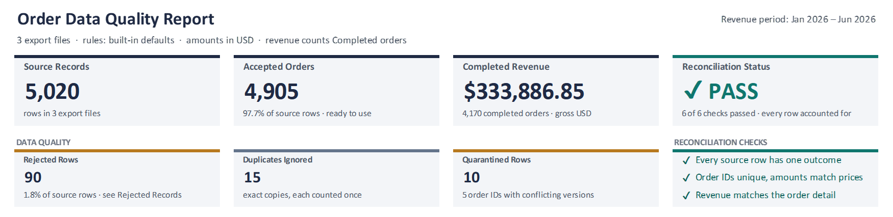
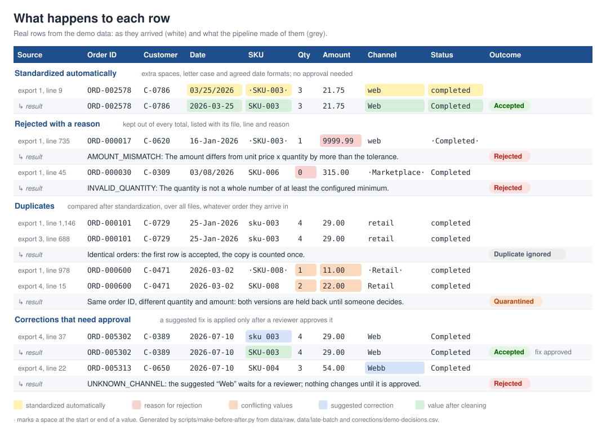
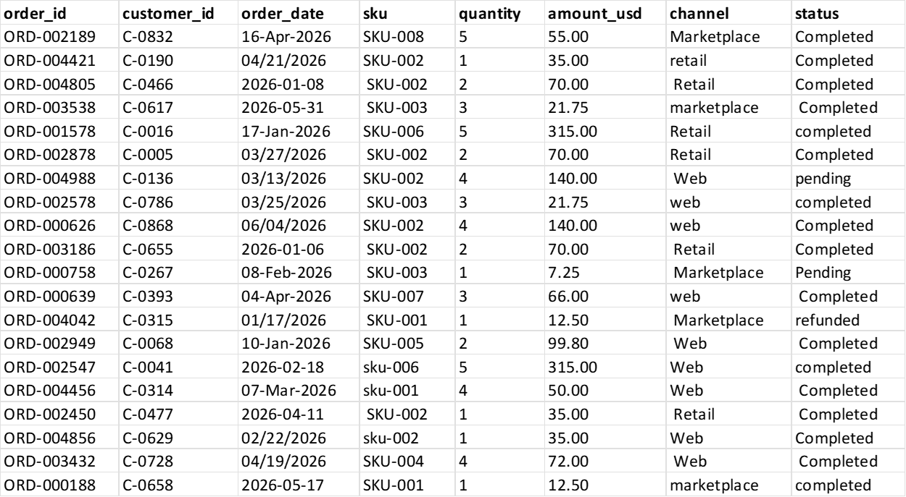
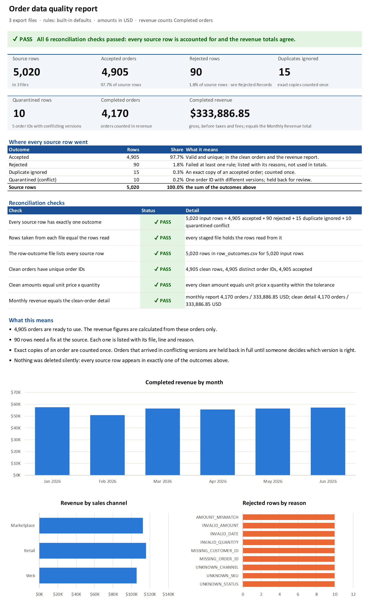
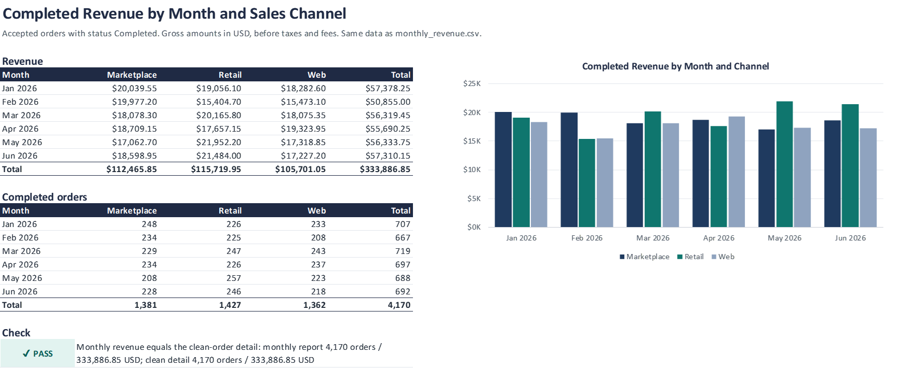
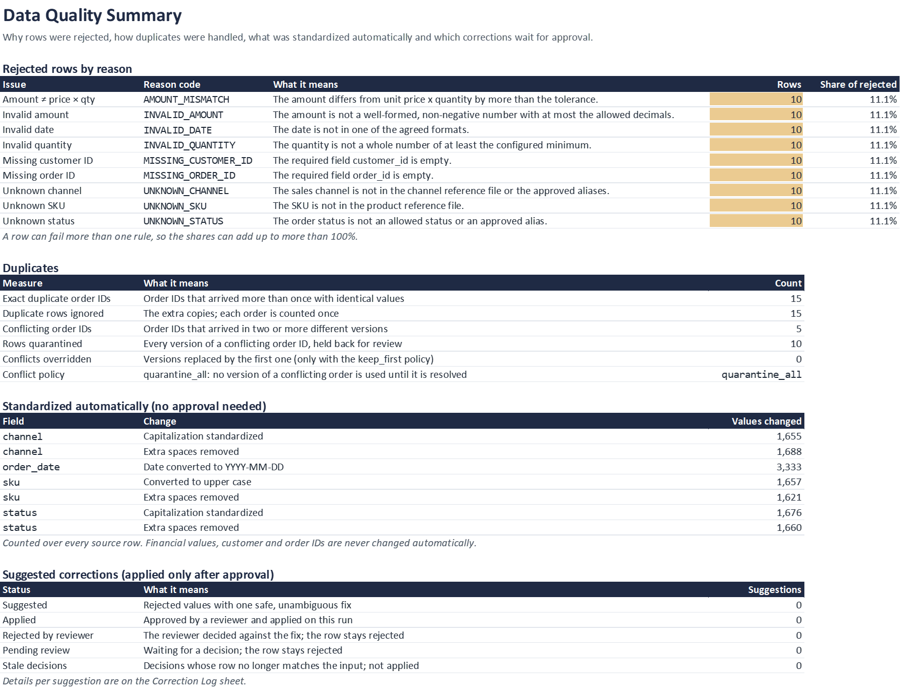
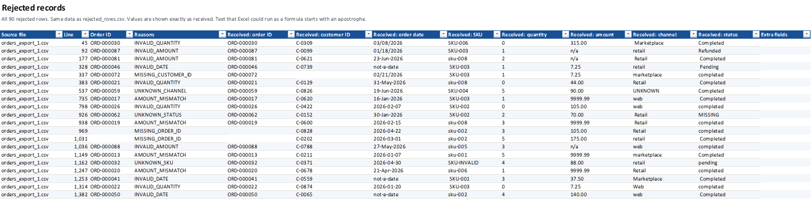
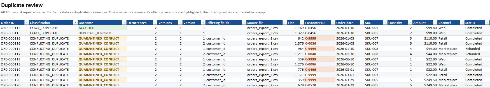
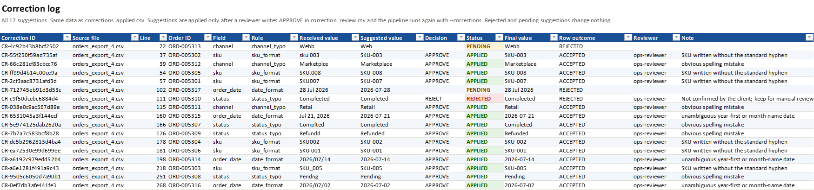

# E-commerce Order Data Quality & Reconciliation

Messy order exports from several sales channels in; clean, de-duplicated, reconciled data and a client-ready Excel report out, with every source row accounted for and every excluded row explained.

> **Status:** pipeline, Excel report, tests and benchmarks complete. **Independent portfolio project with synthetic data:** no real client, customers or orders are involved, and no result here describes a real business.



| Demo run | Day 1: three exports | Day 2: plus a late export and a reviewer's decisions |
|---|---:|---:|
| Source rows | 5,020 | 5,293 |
| Accepted orders | 4,905 | 5,157 |
| Rejected rows, each with file, line and reason | 90 | 99 |
| Exact duplicates counted once | 15 | 22 |
| Rows held back because one order ID has conflicting versions | 10 | 15 |
| Suggested corrections: approved / rejected / still pending | — | 14 / 1 / 2 |
| Completed revenue | $333,886.85 | $352,317.20 |
| Reconciliation checks | 6 of 6 PASS | 6 of 6 PASS |

Both columns come from real runs on the committed demo data: day 1 is asserted by `tests/test_baseline_regression.py`, day 2 is the committed sample output in [`samples/`](samples/), which a test regenerates on every run.

## 1. Business problem

An online retailer sells through a web shop, a marketplace and retail stores, and each channel exports its orders as a CSV file. The files do not agree: dates come in three formats, the same channel is spelled `retail`, ` Retail` or `in store`, SKUs arrive as `sku-002` or `SKU007`, totals sometimes do not match the price list, and the same order turns up twice, sometimes with a different customer or quantity. A file is re-sent by mistake, or a corrected export arrives a week later.

Cleaning this by hand in Excel every month is slow, and nobody can say afterwards which rows were dropped, why the total changed, or whether an order was counted twice. A quick script is not much better if it cannot be checked: the original version of this case study delivered a workbook whose dashboard showed **$667,773.70 instead of $333,886.85**, because its revenue formula included the total row ([baseline audit](docs/baseline-audit.md)).

## 2. Solution overview

A reproducible Python pipeline that a client can run on their own exports, with the rules written in a file they can read:

1. **Read every export as it is.** The header is checked, every row keeps its file name and line number, and a broken line is rejected with a reason instead of stopping the run.
2. **Standardize what is safe.** Spaces, letter case, the agreed date formats and approved aliases (`in store` → `Retail`) are fixed automatically and counted.
3. **Validate against the client's rules** ([`config/rules.toml`](config/rules.toml)): required fields, known SKUs and channels, allowed statuses, and amount = unit price × quantity within $0.01.
4. **Resolve duplicates across all files at once.** Exact copies count once. When one order ID arrives in different versions, every version is held back for review instead of picking one at random, whatever order the files arrive in.
5. **Suggest fixes, apply only approved ones.** Where exactly one safe answer exists (SKU format, a spelling mistake in a status or channel, an unambiguous date), the pipeline suggests it in a review CSV. It is applied only after a reviewer writes `APPROVE`, and the original value, the suggestion and the decision stay in the audit trail. IDs, quantities, amounts and prices are never changed.
6. **Reconcile and report.** Every source row gets exactly one outcome, six reconciliation checks run against independent counts and the files as written, and a failed check fails the run. The results go to CSV files, a JSON quality report and an Excel workbook.
7. **Re-run safely.** Each file is identified by its content hash. A re-sent file is not counted twice, unchanged files are not read again, and an incremental run gives exactly the same results as a full rebuild.


**What happens to individual rows**, taken from a real run on the demo data (regenerated by `scripts/make-before-after.py`):



Design and decisions: [architecture](docs/architecture.md), [feasibility](docs/feasibility.md), [decision records](docs/decisions/README.md). Commands, rules, output columns and codes: [reference](docs/reference.md).

## 3. Demonstrated capabilities

- **Excel and CSV data cleanup:** consolidating several exports, standardizing formats, flagging missing and invalid values, without silently deleting or inventing data.
- **Duplicate detection and reconciliation:** exact and conflicting duplicates across files and batches, row-level accounting, totals that tie back to the detail.
- **Business rules as configuration:** statuses, channels, date formats, tolerances and duplicate policy in a reviewed file, with clear errors for mistakes.
- **Review and approval workflow:** suggested corrections in a spreadsheet, applied only with a reviewer's decision, with a complete audit trail.
- **Client-ready Excel reporting:** an 8-sheet workbook with a dashboard, charts, filters and highlighted exceptions, regenerated from the data on every run.
- **Large and recurring files:** streaming input and on-disk staging, measured up to 1,004,621 rows; incremental runs for daily or monthly exports.
- **Verifiable work:** 202 automated tests, CI, and benchmarks whose every figure comes from a committed result.

## 4. Evidence and measurable results

### Fixes to the original case study

The original project (kept unchanged at the `baseline` tag) reproduced its documented numbers, but the [baseline audit](docs/baseline-audit.md) found thirteen defects. The most important ones, reproduced on the original code and fixed in this version:

| Problem in the original | Original result | Now | Proof |
|---|---|---|---|
| Dashboard revenue formula included the total row | $667,773.70, twice the true figure | $333,886.85, written as a value and checked against the CSV | `test_revenue_is_not_double_counted` |
| Quantity checked with `assert`, which `python -O` removes | 10 zero-quantity orders accepted, revenue $334,654.85 | Rejected in every mode | `test_zero_quantity_is_rejected_under_python_optimize_mode` |
| One export arriving twice under another file name | 1,664 exact and 7 conflicting duplicates instead of 15 and 5 | The repeat is skipped as duplicate content; results unchanged | `test_same_content_under_another_name_is_not_ingested_twice` |
| Month names read with the computer's language setting | German setting: 576 dates rejected, revenue $293,883.05 | Same result on every system | `test_dates_and_generator_do_not_depend_on_the_process_locale` |
| No spreadsheet formula protection | Customer ID `=1+1` reached the clean file as a formula | Written as text | `test_formula_like_values_are_neutralized_in_every_csv` |
| One line with an extra field | The whole run crashed | That row is rejected as `MALFORMED_ROW`; the run continues | `test_rows_with_too_many_or_too_few_fields_are_rejected_not_crashing` |
| Workbook made by hand, outside the code | Not reproducible | Rebuilt on every run, byte-identical for the same inputs | `test_workbook_bytes_are_deterministic` |

On the original 5,020 rows the default rules give the original business result: the same 4,905 clean orders, the same 90 rejected rows and $333,886.85 (`tests/test_baseline_regression.py`). The differences in reporting are listed under [corrections to the baseline rules](docs/reference.md#corrections-to-the-baseline-rules).

### How the numbers reconcile

Every source row ends in exactly one outcome, and the run checks it:

**source rows = accepted + rejected + duplicates ignored + quarantined**
Day 1: 5,020 = 4,905 + 90 + 15 + 10. Day 2: 5,293 = 5,157 + 99 + 22 + 15.

Six checks test this from independent sides rather than re-adding the counters that produced the numbers. Three compare counts: the rows read from each file, the rows staged and the sum of all outcomes, and one line per source row in `row_outcomes.csv`. Three re-read the files as written: unique order IDs in the clean file, every clean amount equal to price × quantity, and monthly revenue equal to the clean detail. Any failure sets the report to FAIL and the run's exit status to 3. Details: [reference](docs/reference.md#reconciliation-checks).

### Tests

`python -m pytest -q` runs 202 unit and integration tests in temporary folders. They cover normalization and validation rules, duplicates and conflicts across files and batches, malformed and wrongly encoded input, invalid configuration, incremental reruns, modified and removed files, reference-data and rule changes, correction approval, rejection and stale decisions, workbook contents and determinism, and row-level traceability. Tests compare the bytes of every business output for a full rebuild, a sequence of incremental runs and batch sizes 1, 7 and 1,000. CI runs them on Python 3.11 and 3.13 ([workflow](.github/workflows/ci.yml)).

### Benchmarks

Measured on one laptop (Windows 11, Intel Core i7-1370P, 32 GB, Python 3.15.2), each run in a fresh process, median of 5 runs (3 for 1M). Every run's results were checked against the generator's expected counts and revenue, and every scenario produced business outputs byte-identical to the full run. All figures: [benchmarks/results/](benchmarks/results/README.md).

| Rows | Files | Full run | Rerun, nothing changed | Rerun, one file added | Peak memory | Original script |
|---:|---:|---:|---:|---:|---:|---|
| 5,020 | 3 | 0.96 s | 0.73 s | 0.80 s | 33 MiB | 0.19 s, 26 MiB |
| 100,469 | 5 | 12.4 s | 8.1 s | 9.9 s | 78 MiB | 1.58 s, 161 MiB |
| 1,004,621 | 10 | 89.5 s | 38.5 s | 44.5 s | 147 MiB | not measured |

What this shows, and what it does not:

- **Memory stays bounded.** Rows are staged in an on-disk database, so ten times the rows took peak memory from 78 MiB to 147 MiB. The original script holds every row in memory and needed 161 MiB for 100,469 rows.
- **The pipeline is slower than the original script**, which only writes four CSV files: 12.4 s against 1.58 s at 100,469 rows. It stores every row with its outcome, runs the checks and builds the workbook. At 100,469 rows the workbook is the largest phase (6.6 of 12.1 s); at 1,004,621 rows reading and staging the rows is (46.2 of 89.2 s), because the workbook's detail sheets stop at 100,000 rows.
- **Incremental runs save the reading, not the rest.** A rerun skips unchanged files, but duplicate resolution, totals, checks and the report are rebuilt from all rows on every run. That is what keeps them identical to a full rebuild, and why a rerun of 1,004,621 unchanged rows still takes 38.5 s.

## 5. Setup and reproduction

Requirements: Python 3.11 or later (tested on 3.11, 3.13 and 3.15) and Git. No database server, no cloud account, no network access while running. Microsoft Excel is only needed to open the report.

```bash
git clone <repository URL>
cd portfolio-data-quality
python -m venv .venv
source .venv/bin/activate              # macOS and Linux
# .venv\Scripts\Activate.ps1           # Windows PowerShell
# source .venv/Scripts/activate        # Windows Git Bash
python -m pip install -r requirements-dev.txt -e .
python -m pytest -q
```

The test run ends with `202 passed` (on Linux `200 passed, 2 skipped`: two tests need Windows file locking or a German locale). Then run the pipeline on the three original exports:

```bash
python -m order_quality run --input data/raw --out output
```

```text
Run 1: PASS  ->  output
  input rows                  5,020
  accepted                    4,905
  rejected                       90
  duplicates ignored             15
  quarantined                    10
  revenue (Completed) 4,170 orders, USD 333,886.85
  check row_accounting               PASS
  ...
```

Open `output/order_quality_report.xlsx`. To see day 2, add the late export and the reviewer's decisions; only the new file is read:

```bash
python -m order_quality run --input data/raw --input data/late-batch --corrections corrections/demo-decisions.csv --out output
```

To review corrections yourself, copy `output/correction_review.csv`, write `APPROVE` or `REJECT` in its `decision` column, and pass your copy with `--corrections`. A larger dataset with known expected results:

```bash
python -m order_quality generate --scenario scale --rows 100000 --files 5 --seed 1 --out bench-data
python -m order_quality run --input bench-data/raw --reference bench-data/reference --out bench-output
```

All options, exit codes and the correction workflow: [docs/reference.md](docs/reference.md).

### Outputs

| File | What it holds |
|---|---|
| `order_quality_report.xlsx` | The Excel report: dashboard, monthly revenue, data quality, rejected records, duplicate review, correction log, clean orders, processing audit |
| `clean_orders.csv` | Accepted orders, standardized, each with its source file and line |
| `rejected_rows.csv` | Rejected rows exactly as received, with reason codes |
| `duplicates_review.csv` | Every row of a repeated order ID, its version and the fields that differ |
| `monthly_revenue.csv` | Completed orders and revenue by month and sales channel |
| `row_outcomes.csv` | One line per source row: its outcome, reasons and corrected fields |
| `correction_review.csv`, `corrections_applied.csv` | Suggested fixes for review, and what was applied, rejected or is still pending |
| `quality_report.json` | Counts, revenue, issue statistics and the reconciliation checks, for other systems |

[`samples/`](samples/) holds these files from the day-2 run, so you can open the workbook without installing anything.

## 6. Screenshots

All images are captured from workbooks generated by the pipeline on the demo data (`scripts/capture-screenshots.ps1`), showing the sheet area only.

**The raw export as received:** mixed date formats, stray spaces, inconsistent capitalization.



**Executive Dashboard:** overall status, headline numbers, where every row went, the six checks, and charts of monthly revenue, revenue by channel and rejected rows by reason.



**Monthly Revenue:** completed revenue and order counts by month and channel, with totals and the reconciliation check.



**Data Quality Summary:** rejected rows by reason in plain language, duplicate statistics and the conflict policy, values standardized automatically, and corrections by status.



**Rejected Records:** every rejected row with its file, line, reasons and the values exactly as received.



**Duplicate Review:** every occurrence of a repeated order ID; conflicting versions highlighted and the differing values marked.



**Correction Log (day 2):** each suggestion with the value received, the suggested value, the reviewer's decision and the final value.



## 7. Technical stack

Python 3.11+ (standard library: `csv`, `sqlite3`, `tomllib`, `decimal`, `hashlib`, `logging`) · XlsxWriter · pytest · openpyxl (tests only) · GitHub Actions

## 8. Scope and limitations

- **Synthetic data, independent project.** All orders, customer IDs, SKUs and prices are fictional and produced by the committed generator. The scenario and its requirements ([docs/CLIENT_BRIEF.md](docs/CLIENT_BRIEF.md)) are simulated; there was no client.
- **One machine.** Benchmarks come from one laptop with other software running. Absolute times depend on the hardware; compare the scenarios with each other.
- **Scalability.** Memory is bounded by the batch size and the database cache rather than by the input size; disk use grows with it (outputs and state: 51 MiB for 100,469 rows, 473 MiB for 1,004,621 rows). Every run recomputes duplicates, totals and outputs over all rows, so run time grows with the total data, not only with the new files. Excel detail sheets show at most 100,000 rows (configurable) with a note pointing to the complete CSV file.
- **Input:** CSV files only. Save Excel sheets as "CSV UTF-8" first.
- **Money:** gross revenue in one currency. No taxes, fees, currency conversion or refund netting.
- **Corrections:** rule-based suggestions only, no AI. Anything ambiguous stays rejected for a person to decide.
- **Possible next steps,** if a real workload needs them: Excel input, faster incremental runs for very large histories, parallel validation, a review screen instead of the review CSV. Each is assessed in [feasibility](docs/feasibility.md#deferred).

## Repository layout

| Path | Contents |
|---|---|
| `src/order_quality/` | The pipeline: reader, rules, validation, corrections, staging, duplicate resolution, outputs, workbook, generator, command line |
| `config/rules.toml` | Default validation rules (equal to the original business rules) |
| `data/` | The original three exports, reference data and the day-2 late export |
| `corrections/` | The reviewer's demo decisions |
| `samples/` | Outputs of the day-2 demo run, including the Excel report |
| `tests/` | Unit and integration tests; `tests/fixtures/baseline/` holds the original outputs |
| `benchmarks/` | Benchmark harness and committed results |
| `docs/` | Baseline audit, feasibility, architecture, decision records, reference, case study, roadmap |
| `assets/` | Workbook screenshots and diagrams |
| `scripts/` | Screenshot and diagram generation, repository checks |

## License

MIT. See [LICENSE](LICENSE).
