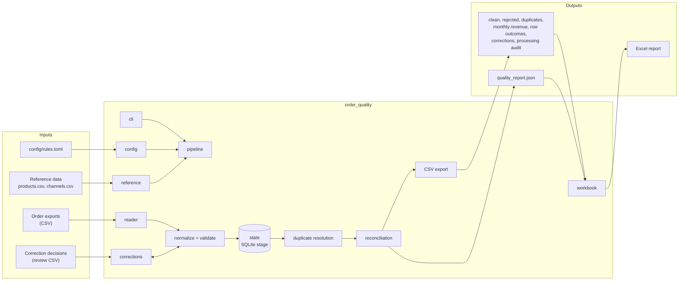

# Architecture

How the pipeline turns order exports into clean, reconciled CSV files and an Excel report. This document is the design agreed before implementation ([feasibility.md](feasibility.md), [decision records](decisions/README.md)); the implementation status of each part is tracked in [roadmap.md](roadmap.md). Command-line options, rule keys, output columns and codes are listed in [reference.md](reference.md).

## Goals and principles

| Principle | How it is applied |
|---|---|
| Every source row has exactly one traceable outcome | A row-level outcome file; reconciliation checks that fail the run |
| Same inputs and rules, same results | Explicit sort orders, no timestamps in business outputs, deterministic workbook bytes |
| Results do not depend on how they were computed | Full rebuild, incremental runs and any batch size give byte-identical business outputs (tested) |
| No silent changes to data | Safe normalization is counted; any other repair needs an approved decision |
| Business rules separate from infrastructure | Rules in `config/rules.toml`; checks in pure functions; files and SQLite in their own modules |
| Bounded memory | Rows are streamed and staged on disk; grouping and sorting happen in SQLite |
| Minimal operations | One local process, the Python standard library and XlsxWriter; no services, no network |

## Components

`pipeline` calls each component in turn (see [Run lifecycle](#run-lifecycle)); the arrows show how data moves.

## Data flow

```mermaid
flowchart LR
    A["Input file"] -->|"SHA-256, classify:<br/>new, changed, unchanged,<br/>removed, duplicate content"| B{"Restage?"}
    B -->|no| S[("Staged rows")]
    B -->|yes| C["Read records<br/>(header check, physical line,<br/>malformed rows flagged)"]
    C --> D["Normalize<br/>(trim, case, approved mappings)"]
    D --> E["Apply approved corrections;<br/>collect new suggestions"]
    E --> F["Validate<br/>(issue codes)"]
    F -->|"batched insert,<br/>one transaction per file"| S
    S --> G["Resolve duplicates<br/>by order ID over all valid rows"]
    G --> H["Assign one outcome per row"]
    H --> I["Aggregate monthly revenue"]
    I --> J["Reconciliation checks"]
    J --> K["Write outputs:<br/>temporary file, then replace"]
```

## Module responsibilities

| Module | Responsibility | Interface |
|---|---|---|
| `errors` | Stable issue codes, row outcomes, error codes and exit statuses | `OrderQualityError` subclasses (`ConfigError`, `InputError`, `StateError`, `OutputError`), each with a `code` |
| `config` | Read `rules.toml`, check it against the schema, freeze it for the run | `load_rules(path) -> Rules`; `Rules` also carries the file's hash for the staging key |
| `reference` | Load product prices and channels | `load_reference(folder, rules) -> Reference` |
| `reader` | Stream one file: encoding, header check, physical start line of each record, malformed records flagged instead of raised | `file_sha256(path)`, `read_records(path, encoding) -> Iterator[Record]` |
| `normalize` | Pure parsing: dates (English month names, any locale), quantities (ASCII digits), amounts (integer cents), canonical values and approved mappings | Plain functions, no I/O |
| `validate` | Turn one raw record into normalized values plus issue codes and the normalizations applied; compute the duplicate fingerprint | `RowChecker(rules, reference).check(raw, malformed) -> CheckedRow`, `fingerprint(row, fields)` |
| `corrections` | Suggestion rules, reading decisions, matching them to rows, the correction audit | Review and decision CSV files |
| `state` | SQLite schema, file registry, staging, run history | One connection per run; one transaction per restaged file |
| duplicate resolution | Group valid rows by order ID, classify, apply the conflict policy | Ordered SQL over the stage |
| reconciliation | Row accounting, revenue totals re-read from the written clean file, uniqueness, price × quantity, per-file row counts | Result list with PASS or FAIL per check |
| CSV export | Write each output with the formula-injection guard, UTF-8 with BOM, a temporary file and an atomic replace | One writer per output file |
| `workbook` | Build the Excel report from the written outputs | Reads the output folder; writes one `.xlsx` |
| generator | Synthetic data: the original scenario byte-identical, scale datasets with their expected results, the "day 2" batch | `python -m order_quality generate` |
| `pipeline` | Run lifecycle (below) | One function per run |
| `cli` | Arguments, logging setup, exit statuses | `python -m order_quality` / `order-quality` |

Business rules live only in `config`, `normalize` and `validate`, which do no I/O and are tested directly. Files, SQLite and Excel stay in `reader`, `state`, the export layer and `workbook`.

## Interfaces between stages

| From → to | Contract |
|---|---|
| reader → validate | `Record`: physical start line, the eight business fields as raw text (located by header name, any column order, extra columns ignored), extra fields, a malformed flag |
| validate → state | `CheckedRow`: normalized values, quantity as an integer, amount in integer cents, issue codes, normalizations applied; plus the source file name and line, and the raw values for the rejected-rows report |
| state → duplicate resolution | Staged valid rows with order ID and fingerprint, indexed by order ID |
| duplicate resolution → reconciliation and export | One outcome per staged row: `ACCEPTED`, `REJECTED`, `DUPLICATE_IGNORED`, `QUARANTINED_CONFLICT` (and `CONFLICT_OVERRIDDEN` under `keep_first`) |
| export → workbook | The written CSV files and `quality_report.json`, so the workbook can only show what the CSV files contain |

## Processing state

The SQLite file (by default in the output folder, never committed) holds:

| Table | Content |
|---|---|
| Files | Path, file name, size, SHA-256, row count, staging key, last action |
| Staged rows | Source file and line, raw values, normalized values, amount in cents, issue codes, normalizations, fingerprint, valid flag |
| Runs | Start and end, mode (full or incremental), rules and reference hashes, counts, per-phase timings |
| Metadata | State schema version, normalization code version |

A file's staging key combines its content hash, the rules hash, the reference data hash, the normalization code version and the hash of the correction decisions that target that file.

## Run lifecycle

1. **Load and check configuration** (`CFG` errors stop the run before any data is read).
2. **Load reference data** (`IN005`) and the correction decisions, if given (`IN006`).
3. **Open the state.** An unreadable or incompatible state file stops the run (`ST001`, `ST002`) with the advice to rerun with `--full-rebuild`. `--full-rebuild` deletes the state first.
4. **Scan inputs** in sorted path order, hash each file, and classify it. Two input files with the same file name stop the run (`IN007`), because the file name is the row's source reference.
5. **Restage** each new or changed file, or each file whose staging key changed, in one transaction: read, normalize, apply approved corrections, validate, insert in batches. Remove the rows of files that are no longer present.
6. **Resolve duplicates** over all staged valid rows and assign one outcome per row.
7. **Aggregate** monthly revenue by channel for the revenue statuses.
8. **Write the CSV outputs**, each to a temporary file in the output folder and then moved into place.
9. **Reconcile** against the written files and write `quality_report.json` with the results. Any failed check makes the run exit with status 3.
10. **Build the workbook** from the outputs, unless `--no-workbook` is given.
11. **Record the run** in the state and append a structured entry to `run_log.jsonl`.

## Incremental processing

| File classification | Action |
|---|---|
| New | Stage |
| Changed (different content hash) | Delete its old rows, stage again |
| Unchanged, same staging key | Keep its rows; do not read the file |
| Unchanged, staging key differs | Stage again |
| Same content as a file earlier in path order | Skip at file level; list as `SKIPPED_DUPLICATE_CONTENT` in the processing audit, with its row count; not part of row accounting |
| Removed (in the state, not in the inputs) | Delete its rows |

Every file is restaged automatically when the rules file, the reference data, the normalization code version or the state schema version changes; the log names the reason. A full rebuild is needed by hand only to recover from a damaged state file, or to start over on purpose (`--full-rebuild`).

Duplicate resolution, totals, checks and outputs are recomputed from all staged rows on every run. Duplicates spread across batches are therefore found wherever they are, a late conflicting record moves an earlier accepted order to quarantine, and the results equal a full rebuild over the same files. Tests compare a full rebuild, a sequence of incremental runs and different batch sizes byte for byte.

## Failure handling and recovery

| Failure | Behavior |
|---|---|
| Invalid configuration | Stops before reading data; `CFG` code, key path and fix; exit status 2 |
| Missing input path, no input files, missing or repeated columns, text not in the configured encoding | Stops with an `IN` code naming the file; exit status 4. A file is never skipped silently |
| Malformed record (wrong field count, unparseable CSV) | Rejected with `MALFORMED_ROW` at its physical line; the run continues |
| Crash or interruption while staging a file | That file's transaction rolls back; the next run restages it |
| Output file locked (for example open in Excel) | Stops with `OUT001` and the file name; earlier outputs are already complete, rerun after closing the file |
| Failed reconciliation check | All outputs are written so the cause can be inspected; exit status 3 |
| Unexpected error | Exit status 1 with the error logged |

Each output file is replaced atomically, so a reader never sees a half-written file. Rerunning with the same inputs always rebuilds every output.

## Determinism

- Inputs are processed in sorted path order; every query has an explicit `ORDER BY`.
- Exact duplicates keep the occurrence with the smallest (source file, source line).
- Business outputs contain no timestamps or run IDs; those go to `processing_audit.csv`, `run_log.jsonl` and the state.
- Line endings and encoding of every CSV and JSON output are fixed, independent of the operating system.
- The workbook has fixed document properties, so it is byte-identical when regenerated on the same operating system. Across systems its content is the same, but XlsxWriter ends each XML part's declaration line with the platform's line ending (CRLF on Windows).

## Security and robustness

- **Formula injection:** text cells that start with `=`, `+`, `-`, `@`, a tab or a carriage return are prefixed with `'` in CSV outputs that echo input text. The workbook writes input text as text, never as a formula.
- **Encoding:** explicit (UTF-8 with or without BOM by default); undecodable text stops the run instead of being replaced.
- **Files:** outputs go to a temporary file in the target folder and are then moved into place; tests write only to temporary folders.
- **Data:** synthetic only, from the committed generator. No network access, no credentials.
- **Money:** integer cents and `Decimal`; never floating point.

## Dependencies

| Dependency | Use | Scope |
|---|---|---|
| Python 3.11+ standard library | CSV, SQLite, TOML, hashing, decimals, logging, arguments | Runtime |
| XlsxWriter | Writing the Excel report | Runtime |
| pytest | Test runner | Development |
| openpyxl | Reading workbooks back in tests | Development |

Exact tested versions are pinned in `requirements-dev.txt` ([ADR-001](decisions/ADR-001-python-standard-library-first.md)).

## Deviations from the reference architecture

The brief proposed Input CSV/Excel → reader (streaming/batching) → normalization → configurable validation → deduplication and conflict resolution → reconciliation and audit → reporting and export, with optional SQLite staging. Where this design differs:

| Reference | This design | Why |
|---|---|---|
| CSV or Excel input | CSV only | Excel input needs a runtime dependency and its own validation for typed cells; deferred ([feasibility.md](feasibility.md#deferred)) |
| Streaming through every stage | Streaming up to the stage; duplicate resolution, totals and export are SQL over the stage | Duplicates need all rows of an order ID together; SQLite groups and sorts on disk ([ADR-003](decisions/ADR-003-sqlite-staging.md)) |
| Deduplication as a pipeline step | Resolution after all files are staged, independent of order | The baseline's streaming comparison changed counts with file order ([ADR-004](decisions/ADR-004-order-independent-duplicate-resolution.md)) |
| Incremental processing of new data | Restage changed files, recompute global stages | Equal to a full rebuild by construction ([ADR-005](decisions/ADR-005-incremental-processing.md)) |
| Correction review workflow | A review CSV with a decision column | Works in Excel; no server ([ADR-006](decisions/ADR-006-assisted-correction-review.md)) |
| Reconciliation and audit | Checks re-read the written files rather than reuse the counters | The baseline's arithmetic check passed while the data was wrong |
| SQLite "if justified" | Used, for both scale and state | One mechanism instead of two |
