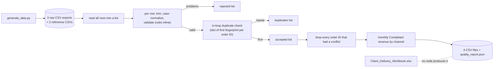

# Baseline audit

Audit of the original case study, kept unchanged as the `baseline` tag. Every result below was produced by running the baseline code; nothing is estimated. The audit was written before the redesign, and its findings drive [feasibility.md](feasibility.md), [architecture.md](architecture.md) and the [decision records](decisions/README.md).

| | |
|---|---|
| **Audited state** | tag `baseline` (the original archive, unchanged apart from a `.gitattributes` file that keeps data files byte-exact) |
| **Date** | 2026-11-08 |
| **Environment** | Windows 11 (build 10.0.26200), x86-64, Python 3.15.2, 13th Gen Intel Core i7-1370P (20 logical processors), 31.6 GB memory. Default `LC_TIME` locale: `C` |
| **Verdict** | The documented numbers reproduce exactly. The workbook does not, and its headline revenue figure is wrong. The cleaning logic has thirteen defects, most of them latent on the demo data. |

## 1. What the baseline contains

| Path | Role |
|---|---|
| `src/generate_data.py` | Generates 5,000 synthetic orders with `random.seed(20261108)`, injects 90 single-field faults (10 each of 9 kinds), appends 15 exact and 5 conflicting duplicates, shuffles, and writes three exports plus two reference files |
| `src/clean_orders.py` | One `run()` function: read every row, normalize, validate, deduplicate, aggregate, write the outputs |
| `tests/test_pipeline.py` | Five `unittest` tests that run the pipeline on the committed data |
| `data/raw/`, `data/reference/` | Three exports (5,020 rows), product prices, channels |
| `data/processed/` | Four CSV files, `quality_report.json` and `Client_Delivery_Workbook.xlsx` |
| `docs/CLIENT_BRIEF.md` | Simulated client requirements R1–R7 and acceptance criteria |



Every rule (date formats, statuses, tolerance, duplicate policy) is written inside `run()`. All rows and all outputs are held in Python lists and dictionaries until the end of the run.

## 2. Reproduction

From a clean extract of the tag:

```bash
git archive baseline | tar -x -C <empty-folder>
cd <empty-folder>
python -I src/generate_data.py
python -I src/clean_orders.py
python -I -m unittest discover -s tests -v
```

| Claim (README and client brief) | Observed | Match |
|---|---|---|
| 5,020 source rows in three exports | 5,020 (1,674 + 1,673 + 1,673 data rows) | Yes |
| 4,905 accepted clean orders | 4,905 | Yes |
| 90 rejected rows | 90: 10 each of `AMOUNT_MISMATCH`, `INVALID_AMOUNT`, `INVALID_DATE`, `INVALID_QUANTITY`, `MISSING_CUSTOMER_ID`, `MISSING_ORDER_ID`, `UNKNOWN_CHANNEL`, `UNKNOWN_SKU`, `UNKNOWN_STATUS` | Yes |
| 20 duplicate occurrences (15 exact, 5 conflicting) | 15 `EXACT_DUPLICATE`, 5 `CONFLICTING_DUPLICATE` | Yes |
| 5 previously accepted originals quarantined | 5 | Yes |
| All rows accounted for | 4,905 + 90 + 20 + 5 = 5,020, `unique_source_row_accounting: true` | Yes |
| 4,170 completed orders, $333,886.85 completed revenue | 4,170 and 333886.85 | Yes |
| Five automated tests pass | 5 passed in 0.269 s | Yes |
| Reruns give identical accepted rows | Yes, `clean_orders.csv` is byte-identical between runs | Yes |

Byte-for-byte comparison with the committed files:

| File | Result |
|---|---|
| `data/raw/*.csv`, `data/reference/*.csv` (regenerated) | Identical |
| `clean_orders.csv`, `rejected_rows.csv`, `duplicates_review.csv`, `monthly_revenue.csv` | Identical |
| `quality_report.json` | Same content; line endings differ. The archive was created on a Unix system (LF); on Windows, `Path.write_text` writes CRLF. Output bytes depend on the operating system |
| `Client_Delivery_Workbook.xlsx` | Cannot be compared: no committed code writes a workbook |

Runtime on the 5,020 rows: median 0.070 s over 5 runs (range 0.068–0.085 s). Peak traced Python memory (`tracemalloc`, 3 runs): 6.4–7.2 MiB.

### The delivered workbook

The workbook has five sheets: Dashboard, Monthly Summary, Rejected Rows, Duplicate Review, Clean Orders Preview (the first 400 of 4,905 clean orders). Its structure (no document properties, generated relationship IDs) indicates that it was produced by a separate tool that is not in the archive. It has no charts, filters, tables or conditional formatting; four of the five sheets freeze the header row.

**The dashboard's revenue is wrong.** Cell `E5` ("Gross completed revenue (USD)") holds `SUM('Monthly Summary'!D2:D22)`. That range includes the TOTAL row (`D20`), so the dashboard shows **667,773.70, exactly twice the true $333,886.85**, both as the stored value and after Excel recalculates. The monthly sheet's own total is correct. Money is stored as binary floating point, so the stored values carry artifacts such as `333886.85000000003`.

## 3. Defects

Numbered as referenced from the new test suite and decision records. "Latent" means the committed demo data does not trigger it, but ordinary client data would.

| # | Defect | Reproduction and observed result | Impact |
|---|---|---|---|
| 1 | Quantity is validated with `assert qty>0`, which Python removes when run with `-O` | `python -I -O`: 4,915 accepted, 80 rejected, 0 `INVALID_QUANTITY`, 4,179 completed orders, revenue **334,654.85**. The accounting check still reports `true` | Wrong totals with no warning |
| 2 | `int()` accepts non-ASCII digits and underscores | Quantity `٣` (Arabic-Indic three) and `1_0` are accepted as 3 and 10 | Unexpected values pass validation |
| 3 | `rejected_rows.csv` has two `order_id` columns, and the normalized ID is overwritten by the raw one | Raw `" ord-000920 "` appears unchanged in both columns | Machine readers rename or drop a column; normalized ID lost |
| 4 | No header or field-count check | A row with an extra field stops the run with `AttributeError: 'list' object has no attribute 'strip'`; a file without the `status` column stops it with `KeyError: 'status'` | One bad line blocks the whole delivery |
| 5 | Duplicate classification depends on row order: after a conflict the first fingerprint is replaced by `None`, so a later exact copy is counted as conflicting | Rows A, A, A′ give 1 exact + 1 conflicting; A, A′, A give 2 conflicting. Re-ingesting one export under a second file name gives 1,664 exact and **7** conflicting duplicates instead of 15 and 5. Reversing the committed data gives the same counts, because no order ID there has three versions | Counts change with file order and batch split; no stable basis for incremental runs |
| 6 | `money()` removes every comma, accepts exponent notation and rounds silently | `"1,2,3"` → 123.00, `"1,2.50"` → 12.50, `"1e2"` → 100.00, `"12.504"` → 12.50; rows with `1,2.50`, `12.504` and `1e2` are accepted | Malformed amounts turn into plausible numbers |
| 7 | Month names in `%d-%b-%Y` depend on the process `LC_TIME` locale (latent: the scripts never set it) | With `LC_TIME=de_DE.UTF-8` in the process: 576 `INVALID_DATE` instead of 10, 4,351 accepted, revenue 293,883.05, accounting still `true`; the generator writes `05-Mai-2026` instead of `05-May-2026` | Results depend on the machine or host application |
| 8 | No CSV or Excel formula-injection protection | Customer ID `=1+1` is accepted into `clean_orders.csv`; channel `=HYPERLINK(...)` is echoed into `rejected_rows.csv` | A spreadsheet opened by the client can execute formulas |
| 9 | Outputs are overwritten in place, and the tests write into the committed `data/processed/` | After the test run on Windows, `quality_report.json` differs from the committed file | A failed run can leave half-written outputs; tests change tracked files |
| 10 | `source_line` counts records, not physical lines | After a quoted field containing a line break, a rejected row that starts on line 4 is reported as line 3 | Traceability points to the wrong line |
| 11 | Generator comment says the 5 conflicts change the amount; the code changes `customer_id` to `C-9999` | All 5 conflicting order IDs differ only in `customer_id` | Documentation does not match the data |
| 12 | The workbook is not reproducible and its dashboard revenue is doubled (section 2) | `E5` = 667,773.70 | The client's headline number is wrong |
| 13 | The self-check is arithmetic over the same counters, not a per-row reconciliation; `quarantined_valid_rows` is simply the number of conflicting IDs | The check passes in defects 1 and 7, where the data is wrong | A green check does not prove correct results |

## 4. Limitations by design

| Area | Baseline behavior | Consequence |
|---|---|---|
| Memory | Every source row, every output row and every accepted fingerprint is held in memory until the run ends | Memory grows linearly with input; fine at 5,000 rows, not a basis for 1,000,000 |
| Rules | Formats, statuses, tolerance and duplicate policy are written in `run()` | Any rule change is a code change |
| Incremental processing | None: every run re-reads every file; files have no identity or content hash | Re-sending a file doubles its rejected rows (90 → 113 when one export arrives twice) and adds 1,671 duplicate occurrences |
| Rejected rows and duplicates | A rejected row never takes part in duplicate detection | Documented behavior; kept in the redesign |
| Duplicate review | Lists order ID and classification only | A reviewer cannot see which field differs or which version was kept |
| Error handling | One `RuntimeError` for "no input files"; no codes, no logging, no command-line options | Failures are hard to act on |
| Tests | Five tests, `>=` assertions, no edge cases, no isolation from committed files | Defects 1–13 are not caught |
| Encoding | UTF-8 with or without BOM; any other encoding raises an unhandled `UnicodeDecodeError` | Same as defect 4: one file blocks the run |

## 5. Recommended improvements

| Recommendation | Addresses | Where it is decided |
|---|---|---|
| Validate with explicit checks and strict patterns (ASCII digits, well-formed amounts with at most two decimals, English month names independent of locale) | 1, 2, 6, 7 | [ADR-002](decisions/ADR-002-validation-rules-in-toml.md) |
| Streaming reader with header and field-count checks; malformed rows rejected with `MALFORMED_ROW`, reported on their physical start line | 4, 10 | [architecture.md](architecture.md) |
| Order-independent duplicate resolution over all valid rows | 5 | [ADR-004](decisions/ADR-004-order-independent-duplicate-resolution.md) |
| Rules in a configuration file whose defaults equal the baseline rules | Rules | [ADR-002](decisions/ADR-002-validation-rules-in-toml.md) |
| SQLite staging and content-hashed file identity for incremental runs | Memory, incremental, 5 | [ADR-003](decisions/ADR-003-sqlite-staging.md), [ADR-005](decisions/ADR-005-incremental-processing.md) |
| Formula-injection guard, temporary file then replace, fixed line endings | 8, 9 | [architecture.md](architecture.md) |
| Row-level outcome file and independent reconciliation checks that fail the run | 13 | [architecture.md](architecture.md) |
| Workbook generated from the outputs, with deterministic bytes and formulas that cannot double-count | 12 | [ADR-007](decisions/ADR-007-excel-report.md) |
| Unit and integration tests in temporary folders, including a regression test per defect | 9, all | [feasibility.md](feasibility.md) |
| Correct the generator comment; keep the generated bytes identical | 11 | Generator port |

The original 5,020-row scenario stays as the regression fixture: the default rules must reproduce 4,905 accepted orders, 90 rejected rows and $333,886.85, or document each justified difference.
